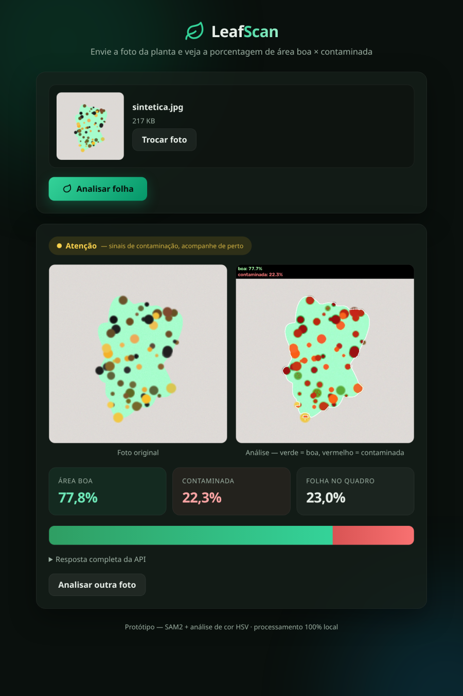
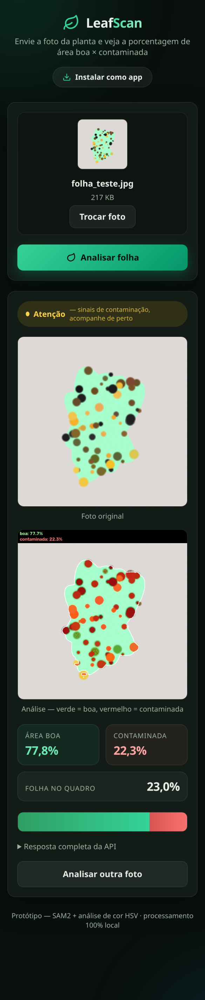

# LeafScan

Análise de folhas por foto: envie a imagem de uma planta e receba a **porcentagem de área boa × contaminada**, com uma imagem de destaque das regiões doentes.

| Desktop | Mobile |
| --- | --- |
|  |  |

Protótipo **100% local**: segmentação da folha com SAM2 e classificação de pixels por cor. Nenhum dado é enviado a serviços externos — o navegador apenas conversa com a API rodando na sua máquina.

## Como funciona

1. **Detecção da folha** — blobs verdes (HSV) geram bounding boxes iniciais; o **SAM2** (modelo `sam2.1_t`) refina cada região e produz a máscara da folha. Se o SAM2 não estiver disponível, a máscara de cor é usada como fallback.
2. **Classificação pixel a pixel** — dentro da máscara, cada pixel é classificado por cor:
   - **Saudável**: verde saturado (matiz 35–90, saturação ≥ 60)
   - **Contaminado**: amarelo, marrom, preto ou cinza (clorose, necrose, tecido seco)
3. **Porcentagem** — `contaminada (%) = pixels doentes ÷ pixels da folha × 100`

A página web exibe o veredito (saudável / atenção / ação recomendada), a foto original ao lado da análise com overlay, cards com as porcentagens animadas e o JSON bruto da resposta.

## Tecnologias

- Python 3.12 · FastAPI · Uvicorn
- [Ultralytics SAM2](https://docs.ultralytics.com/models/sam-2/) (checkpoint tiny) · OpenCV · NumPy
- PyTorch (build CPU)
- Front-end: HTML/CSS/JS puro, sem dependências — **PWA instalável** (service worker + manifest)

## Requisitos

- Python 3.12
- [cloudflared](https://developers.cloudflare.com/cloudflare-one/connections/connect-networks/get-started/create-remote-tunnel/) (opcional, para acesso pelo celular em redes com isolamento de AP)

## Como executar

```bash
git clone https://github.com/KiuryMariano/leafscan.git
cd leafscan

python3.12 -m venv .venv
source .venv/bin/activate

# instale o PyTorch CPU antes para evitar o download dos wheels CUDA (~2,5 GB)
pip install torch torchvision --index-url https://download.pytorch.org/whl/cpu

pip install -r requirements.txt
uvicorn app.main:app --port 8002
```

Na primeira análise, os pesos do SAM2 (~74 MB) são baixados automaticamente. Depois, abra `http://localhost:8002`.

Para testar o pipeline sem o servidor (gera uma folha sintética com manchas e o overlay correspondente em `outputs/`):

```bash
python test_pipeline.py
```

### Acesso pelo celular

Em redes com isolamento de clientes (AP isolation), exponha o app por um túnel público:

```bash
cloudflared tunnel --url http://localhost:8002
```

O comando imprime uma URL `https://*.trycloudflare.com` com HTTPS válido. No celular, abra a URL, tire a foto da planta e, se quiser, use **"Adicionar à tela inicial"** para instalar o PWA.

## API

| Método | Rota | Descrição |
| --- | --- | --- |
| `POST` | `/api/analyze` | Recebe `multipart/form-data` com o campo `file` (imagem) |
| `GET` | `/api/health` | Status do serviço e modelo carregado |
| `GET` | `/` | Página web |

```bash
curl -F "file=@folha.jpg" http://localhost:8002/api/analyze | jq '{healthy_pct, diseased_pct, leaf_coverage_pct}'
```

```json
{
  "leaf_detected": true,
  "used_sam": true,
  "leaf_coverage_pct": 22.96,
  "healthy_pct": 77.75,
  "diseased_pct": 22.25,
  "overlay_image": "data:image/jpeg;base64,..."
}
```

- `healthy_pct` / `diseased_pct` — porcentagem da área da folha saudável × contaminada
- `leaf_coverage_pct` — quanto da imagem (quadro inteiro) é folha
- `overlay_image` — imagem em base64 com as áreas doentes destacadas em vermelho
- `used_sam` — `false` quando o fallback por cor foi usado em vez do SAM2

Erros: `400` (imagem inválida) e `422` (nenhuma folha detectada).

## Estrutura

```
leafscan/
├── app/
│   ├── analyzer.py       # pipeline: SAM2 + regras HSV + overlay
│   ├── main.py           # FastAPI (rotas /, /api/health, /api/analyze, /sw.js)
│   └── __init__.py
├── static/
│   ├── index.html        # interface completa (upload, preview, resultado, PWA)
│   ├── manifest.webmanifest
│   ├── sw.js             # service worker (cache do shell; /api sempre na rede)
│   ├── icon-192.png
│   └── icon-512.png
├── docs/                 # screenshots para o README
├── outputs/              # saídas do test_pipeline.py (não versionado)
├── test_pipeline.py      # teste ponta a ponta com imagem sintética
└── requirements.txt
```

## Limitações

- A classificação é por cor: lesões de tons semelhantes aos da folha podem escapar
- Não identifica o tipo de doença ou praga, apenas a área comprometida
- Sensível à iluminação e ao fundo — fotos bem iluminadas com fundo neutro funcionam melhor
- Não substitui avaliação agronômica profissional

## Próximos passos

- Fine-tune de um modelo de segmentação (U-Net/DeepLabV3+) com datasets públicos como [PlantSeg](https://github.com/zhangchuang_01/PlantSeg) e [Leaf-Disease-Segmentation-masks](https://huggingface.co/datasets/LeafNet75/Leaf-Disease-Segmentation-masks), para maior precisão em condições de campo

## Licença

Distribuído sob a [licença MIT](LICENSE).
